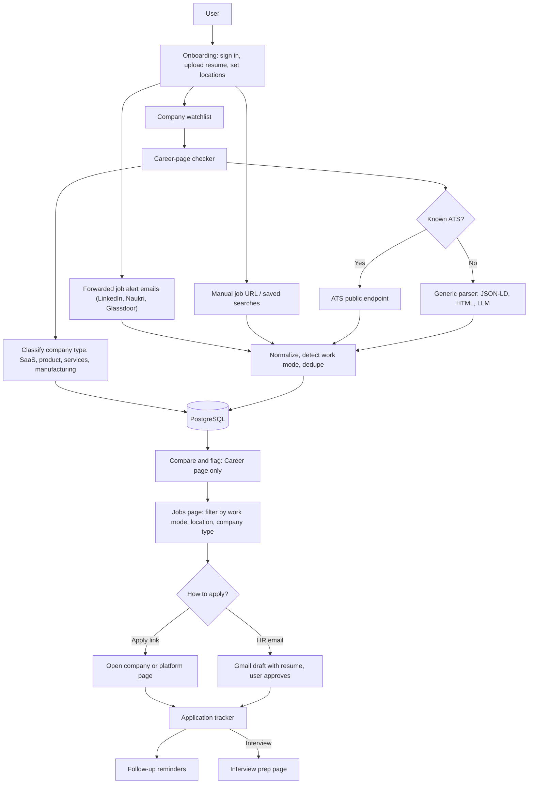

# JobHunt Hub — Build Spec (Next.js)

A job-search dashboard for any job seeker: connect your job profiles, search openings by location, check each company's own career page for roles that are not listed on the platforms, and send your resume with one click.

Use this file as the project brief (README or AI coding prompt) for a new Next.js app.

How it should look and behave is in the companion file `JOBHUNT_DESIGN.md`: layout, colours, typography, components and screen-by-screen notes.

---

## 1. Goals

1. One place to see jobs from LinkedIn, Naukri, Glassdoor and company career pages.
2. Search and filter by work mode (remote, hybrid, on-site), one or more specific locations, company type (SaaS, product, services, manufacturing), role, experience, and date posted.
3. For every company, check its career page and flag openings that exist there but not on the platforms.
4. Send a resume to the company quickly, with the user approving every send.
5. Track every application: status, date, follow-up reminder.
6. Prepare for each interview: likely questions, skills gap and company notes for that job.

## 2. Platform reality (read before building)

None of the three platforms offers a public API to search jobs or apply on a user's behalf. This shapes the whole design.

| Platform | What is officially available | What is not |
|---|---|---|
| LinkedIn | "Sign in with LinkedIn" (OpenID Connect): name, email, photo | Job search and Easy Apply via API (partner-only, closed to new partners) |
| Naukri | Nothing public: no developer portal, no API key | Login, search, apply via API |
| Glassdoor | No open public jobs API (confirm current status before building) | Login, search, apply via API |

Rules that follow from this:

- Never ask for or store a user's platform password or session cookie.
- Do not run logged-in bots or scrapers against these sites. It breaks their terms and gets accounts restricted.
- Do not auto-submit applications on the platforms. Open the platform's own apply page instead.

So "connect account" in this app means the safe options in section 4, and the heavy lifting is done by career-page checking (section 5), which uses open, public endpoints.

## 3. Tech stack (final for v1)

| Layer | Choice | Why |
|---|---|---|
| Framework | Next.js (App Router) + TypeScript | One codebase for UI and API |
| UI | Tailwind CSS + shadcn/ui | Fast to build, consistent components |
| Forms and validation | React Hook Form + Zod | Same schemas on client and server |
| Sign-in | Better Auth with Google and LinkedIn providers | Auth.js (NextAuth) is now in maintenance under the Better Auth team, which recommends Better Auth for new projects |
| Database | PostgreSQL on Supabase + Prisma | Managed Postgres, typed queries |
| Resume storage | Supabase Storage, private bucket, signed URLs | Same vendor as the database |
| Search | Postgres full-text search + indexes | Enough for v1; no separate search engine |
| Background jobs | Inngest | Scheduled and queued work without running Redis or a worker server |
| Job alert intake | Per-user forwarding address + Postmark inbound webhook | Avoids reading the user's Gmail (see section 4) |
| Notification email | Postmark | Same vendor as inbound |
| Sending the resume | Gmail API, `gmail.send` scope only | Mail comes from the user's own address |
| HTML parsing | Cheerio | Career pages and JSON-LD |
| LLM | Vercel AI SDK with one provider | Provider can be swapped without code changes elsewhere |
| Hosting | Vercel | Native Next.js hosting |
| Errors | Sentry | |
| Tests | Vitest for parsers and matching; Playwright for the main user flows | |

Left out of v1 on purpose:
- Headless browser for client-rendered career pages (needs a separate worker server). Those companies show "check manually" with a link.
- Redis, a separate search engine, WhatsApp or Telegram alerts, browser extension.

## 4. "Connect account" — what each connection does

### LinkedIn
- OAuth sign-in with scopes `openid profile email`.
- Store: name, email, photo, LinkedIn profile URL (user pastes it).
- Jobs: build a deep link to LinkedIn job search with the user's keyword and location, opened in a new tab.

### Naukri and Glassdoor
- No OAuth exists. "Connect" = user saves their profile URL and their saved-search URLs.
- Jobs: deep links to the platform search with keyword and location prefilled.

### Job alerts by email (works for all three)
- User turns on job alert emails on each platform (their own setting).
- The app gives each user a private address, for example `alerts-k3x9@in.yourapp.com`.
- User adds a filter in their mailbox to auto-forward job alert emails to that address. The app shows the forwarding confirmation email so the user can complete the mailbox's verification step.
- Postmark posts each forwarded email to `/api/inbound/email`; a background job parses it into `Job` rows: title, company, location, link, source.
- This is the main way platform jobs enter the app without scraping.
- Why forwarding instead of reading Gmail: Google classes `gmail.readonly` as a restricted scope, which adds a yearly security assessment on top of app verification. Forwarding needs no mailbox access at all and works with any email provider.

### Manual add
- Paste any job URL. The app fetches the page once, reads the `JobPosting` JSON-LD if present, and saves it.

### Optional: licensed jobs data API
- Add a provider that calls a paid jobs-data aggregator. Keep it behind the same interface so it can be swapped.

```ts
// lib/providers/types.ts
export interface JobProvider {
  id: string;                       // "email-alerts" | "career-page" | "manual" | ...
  search(q: JobQuery): Promise<NormalizedJob[]>;
}

export type WorkMode = "onsite" | "hybrid" | "remote";
export type CompanyType = "saas" | "product" | "services" | "manufacturing" | "other";

export interface JobQuery {
  keywords: string;
  workModes?: WorkMode[];           // multi-select; empty = all
  locations?: string[];             // ["Pune", "Bengaluru"]; applies to hybrid and on-site
  radiusKm?: number;
  remoteScope?: "india" | "worldwide";
  experienceYears?: [number, number];
  postedWithinDays?: number;
  companyTypes?: CompanyType[];     // multi-select; empty = all
  careerPageOnly?: boolean;
}
```

## 5. Career-page checker (core feature)

Purpose: find openings that are on the company's site but not on LinkedIn, Naukri or Glassdoor.

### Step 1 — Resolve the company
- Input: company name or domain (from a job row, or added to a watchlist).
- Find the careers URL: try `/careers`, `/jobs`, `/join-us`, `/work-with-us`, then links in the homepage footer and `sitemap.xml`.

### Step 2 — Detect the hiring system (ATS)
Most career pages are powered by an ATS with a public job-board endpoint. Detect by the URL or embedded script, then call the endpoint directly.

| ATS | Detect by | Public endpoint |
|---|---|---|
| Greenhouse | `boards.greenhouse.io/{token}` | `https://boards-api.greenhouse.io/v1/boards/{token}/jobs?content=true` |
| Lever | `jobs.lever.co/{company}` | `https://api.lever.co/v0/postings/{company}?mode=json` |
| Ashby | `jobs.ashbyhq.com/{name}` | `https://api.ashbyhq.com/posting-api/job-board/{name}` |
| SmartRecruiters | `careers.smartrecruiters.com/{id}` | `https://api.smartrecruiters.com/v1/companies/{id}/postings` |
| Recruitee | `{company}.recruitee.com` | `https://{company}.recruitee.com/api/offers/` |
| Workable | `apply.workable.com/{account}` | `https://apply.workable.com/api/v1/widget/accounts/{account}` |

Verify each endpoint against the vendor's docs while building; add one adapter file per ATS.

### Step 3 — Fallback for other sites
For Workday, Darwinbox, Keka, Zoho Recruit and custom pages:
1. Fetch the careers page and read `application/ld+json` blocks of type `JobPosting`.
2. If none, extract job cards from the HTML (headings + links); optionally pass the cleaned text to an LLM to return `{title, location, url}[]`.
3. If the page is rendered client-side and nothing can be read, mark the company "check manually" and link to its careers page. A headless browser for these sites comes after v1.

### Step 4 — Compare and flag
- Normalize title (lowercase, strip seniority noise) and location.
- Match against platform jobs for the same company using fuzzy title match + location.
- Set `visibility`:
  - `CAREER_PAGE_ONLY` — on the company site, not seen on any platform (highlight this)
  - `BOTH`
  - `PLATFORM_ONLY` — on a platform, no longer on the company site (may be closed)

### Step 5 — Keep it fresh
- Re-check watchlist companies once a day.
- Notify the user (email or in-app) when a new matching role appears.

### Step 6 — Classify the company type
Each company gets one type, so users can filter for the kind of company they want to work at.

| Type | Meaning | Typical signals on the company's site |
|---|---|---|
| `saas` | Sells its own software as a subscription service | "SaaS", "platform", pricing page, free trial, "book a demo" |
| `product` | Builds and sells its own product (software, app, device, consumer goods brand) that is not subscription software | Product pages, app store links, "our products" |
| `services` | Builds or runs things for clients: IT services, consulting, agencies, outsourcing | "Our clients", "services", "consulting", case studies |
| `manufacturing` | Makes physical goods in its own plants or factories | "Manufacturing", "plant", "factory", production capacity |
| `other` | Anything else: banks, hospitals, education, retail, government | |
| `unknown` | Not enough information yet | |

How the type is set, in this order:
1. Rules: scan the homepage and about page for the signals above; accept only when one type clearly leads.
2. LLM: send the cleaned homepage and about text, get back `{ type, confidence, reason }`; accept at confidence 0.7 or higher.
3. Otherwise `unknown`, shown as "Not classified".

Details:
- Runs once when a company is first added, and again every 90 days.
- A company that does more than one thing gets the type of its main business. `industry` holds a short free-text label next to it, for example "Fintech" or "Auto parts".
- The type lives on the shared `Company` row, with its source and a one-line reason.
- Any user can correct a wrong type. The correction applies to that user's view at once and is saved for review before it changes the shared value.

### Crawling etiquette
- Respect `robots.txt`, identify the bot in the User-Agent, max 1 request per second per domain, cache responses for 12 hours.

## 6. Sending the resume

Every send needs an explicit click from the user. No silent bulk applying.

| Job has | Action |
|---|---|
| Apply link (ATS or platform) | Open the link in a new tab; show a side panel with copy-ready answers and the resume download |
| HR / careers email on the company site | Draft an email with resume attached; user reviews and sends through their Gmail |
| Neither | Show the careers page link and mark as "apply manually" |

Details:
- Resume library: upload several PDFs (for example "Frontend", "Full-stack"), pick a default per role type.
- Email draft: subject, short cover note generated from the job description and resume, editable before sending.
- Limits: max 20 emails a day, one per company per role, to avoid spam flags.
- After sending or clicking apply, create an `Application` row automatically.

## 7. Search and filters

Work mode and location are the two main filters and sit at the top of the jobs page. Defaults come from onboarding and can be changed per search.

| Filter | Options | Notes |
|---|---|---|
| Work mode | Remote, Hybrid, On-site (multi-select) | Jobs with no stated mode show as "Not specified" and are included unless the user hides them |
| Location | One or more cities; "Anywhere in India"; country | Applies to hybrid and on-site jobs |
| Distance | Within 10 / 25 / 50 km of a city | Optional; needs city coordinates |
| Remote scope | Remote in India, Remote worldwide | Many "remote" roles are limited to one country |
| Company type | SaaS, Product, Services, Manufacturing, Other (multi-select) | Companies not yet classified show as "Not classified" and are included unless the user hides them |
| Role / keywords | Free text + saved roles | |
| Experience | Range in years | |
| Date posted | 24 hours, 3 days, 7 days, 30 days | |
| Source | LinkedIn, Naukri, Glassdoor, Career page | |
| Career page only | On / off | Shows roles not seen on any platform |
| Salary | Minimum, when the listing publishes one | Most listings hide salary |

How the filters combine:
- Remote jobs ignore the city filter (they match on remote scope instead).
- Hybrid and on-site jobs must match one of the chosen cities.
- Example: "Remote + Hybrid, Pune" returns all remote roles open to India plus hybrid roles in Pune.
- Company type narrows the result further: adding "SaaS + Product" keeps only jobs at companies of those two types.

Detecting work mode for each job, in this order:
1. A work-mode field from the ATS endpoint, where the ATS provides one.
2. `jobLocationType: TELECOMMUTE` in the page's `JobPosting` JSON-LD.
3. Keywords in the title, location text or description: "remote", "work from home", "WFH", "hybrid", "days in office".
4. Otherwise `unknown`.

Normalizing location:
- Map spellings and old names to one city: Bengaluru / Bangalore, Gurugram / Gurgaon, Mumbai / Bombay.
- Group regions: Delhi NCR covers Delhi, Noida, Gurugram, Ghaziabad, Faridabad.
- A job listing several cities is stored with all of them and matches any.

Saved searches:
- Save any filter set with a name (for example "Remote React, India").
- Each saved search can be used for the daily new-jobs notification.

## 8. Interview prep

Each job keeps one record from the moment it is found until the final outcome. When an application moves to `Interview`, a prep page is created for it automatically; it can also be opened for any saved job.

| Block | What it contains |
|---|---|
| Role summary | Key responsibilities and must-have skills pulled from the job description |
| Skills gap | Skills in the job description that are missing or weak in the resume, with a short study list |
| Likely questions | Technical, role-specific and behavioural questions generated from the job description and resume; user can add their own and write answers |
| Company notes | What the company does, products, careers page, recent news links; editable |
| Checklist | Interview date and time, round type, interviewer names, documents to keep ready, questions to ask them |
| Round notes | Notes and outcome after each round, kept with the application |

Details:
- Generated content is a first draft; everything is editable and saved per application.
- Regenerate button for questions (for example "more system design", "more React").
- Interview date adds a reminder one day before and one hour before.
- This feature needs the LLM key; without it the page still works as manual notes.

## 9. Pages

| Route | Purpose |
|---|---|
| `/` | Landing + sign in |
| `/onboarding` | Sign in, connect Gmail for sending, set up alert forwarding, add Naukri / Glassdoor URLs, upload resume, set preferred work modes, locations, company types and roles |
| `/jobs` | Search with work mode and location filters (section 7), saved searches; job cards with source badges and a "Career page only" tag |
| `/jobs/[id]` | Job detail, company info, apply panel |
| `/companies` | Watchlist; company type; last checked time; open roles count |
| `/companies/[id]` | Career-page openings vs platform openings side by side |
| `/applications` | Kanban: Saved, Applied, Interview, Offer, Rejected |
| `/applications/[id]/prep` | Interview prep for one job: questions, skills gap, company notes, checklist |
| `/settings` | Connections, resumes, daily limits, notifications |

## 10. Data model (Prisma outline)

```prisma
// Better Auth adds its own session, account and verification tables.
model User {
  id            String   @id @default(cuid())
  email         String   @unique
  name          String?
  alertAddress  String   @unique // private forwarding address for job alert emails
  linkedinUrl   String?
  naukriUrl     String?
  glassdoorUrl  String?
  workModes     String[] // onsite | hybrid | remote
  locations     String[]
  companyTypes  String[] // preferred: saas | product | services | manufacturing | other
  roles         String[]
  savedSearches SavedSearch[]
  resumes       Resume[]
  applications  Application[]
  watchlist     CompanyWatch[]
}

model Resume {
  id        String  @id @default(cuid())
  userId    String
  label     String
  fileUrl   String
  isDefault Boolean @default(false)
  user      User    @relation(fields: [userId], references: [id])
}

model Company {
  id          String   @id @default(cuid())
  name        String
  domain      String?  @unique
  careersUrl  String?
  atsType     String?  // greenhouse | lever | ashby | smartrecruiters | recruitee | workable | custom
  atsToken    String?
  hrEmail     String?
  companyType       String  @default("unknown") // saas | product | services | manufacturing | other | unknown
  companyTypeSource String? // rule | llm | reviewed
  companyTypeReason String? // one line shown to the user
  industry          String? // short label, for example "Fintech"
  typeCheckedAt     DateTime?
  lastChecked DateTime?
  jobs        Job[]
}

model Job {
  id          String   @id @default(cuid())
  companyId   String
  title       String
  location    String?  // raw text from the listing
  cities      String[] // normalized, one or more
  country     String?
  workMode    String   @default("unknown") // onsite | hybrid | remote | unknown
  remoteScope String?  // india | worldwide
  url         String
  source      String   // linkedin | naukri | glassdoor | career_page | manual
  visibility  String   // CAREER_PAGE_ONLY | BOTH | PLATFORM_ONLY
  description String?
  postedAt    DateTime?
  firstSeenAt DateTime @default(now())
  lastSeenAt  DateTime @default(now())
  dedupeKey   String   // hash(company + normalizedTitle + normalizedLocation)
  company     Company  @relation(fields: [companyId], references: [id])

  @@index([dedupeKey])
  @@index([workMode])
}

model Application {
  id        String   @id @default(cuid())
  userId    String
  jobId     String
  resumeId  String?
  method    String   // email | apply_link | manual
  status    String   @default("APPLIED")
  appliedAt DateTime @default(now())
  followUpAt DateTime?
  notes     String?
  prep      InterviewPrep?
  user      User     @relation(fields: [userId], references: [id])
}

model CompanyWatch {
  id        String @id @default(cuid())
  userId    String
  companyId String
  user      User   @relation(fields: [userId], references: [id])
}

model CompanyTypeCorrection {
  id        String   @id @default(cuid())
  userId    String
  companyId String
  type      String   // the type this user says is correct
  createdAt DateTime @default(now())

  @@unique([userId, companyId])
}

model SavedSearch {
  id      String  @id @default(cuid())
  userId  String
  name    String
  query   Json    // a JobQuery
  notify  Boolean @default(false)
  user    User    @relation(fields: [userId], references: [id])
}

model InterviewPrep {
  id            String      @id @default(cuid())
  applicationId String      @unique
  roleSummary   String?
  skillsGap     String[]
  questions     Json        // [{ type, question, answer }]
  companyNotes  String?
  checklist     Json        // [{ label, done }]
  interviewAt   DateTime?
  roundNotes    String?
  application   Application @relation(fields: [applicationId], references: [id])
}
```

## 11. Folder structure

```
app/
  (auth)/sign-in/page.tsx
  onboarding/page.tsx
  jobs/page.tsx
  jobs/[id]/page.tsx
  companies/page.tsx
  companies/[id]/page.tsx
  applications/page.tsx
  applications/[id]/prep/page.tsx
  settings/page.tsx
  api/
    auth/[...all]/route.ts          // Better Auth handler
    inngest/route.ts                // Inngest endpoint
    inbound/email/route.ts          // Postmark inbound webhook
    jobs/search/route.ts
    jobs/import-url/route.ts
    companies/check/route.ts
    applications/route.ts
    email/send/route.ts
    resumes/upload/route.ts
    prep/generate/route.ts
lib/
  providers/        types.ts, emailAlerts.ts, manual.ts, careerPage.ts
  ats/              detect.ts, greenhouse.ts, lever.ts, ashby.ts, smartrecruiters.ts, recruitee.ts, workable.ts, generic.ts
  matching/         normalize.ts, dedupe.ts, workMode.ts, cities.ts
  companies/        resolve.ts, classifyType.ts
  email/            gmail.ts, postmark.ts, templates.ts, parsers/linkedin.ts, parsers/naukri.ts, parsers/glassdoor.ts
  prep/             questions.ts, skillsGap.ts, companyNotes.ts
  deeplinks.ts      // LinkedIn / Naukri / Glassdoor search URLs for keyword + location
  auth.ts           // Better Auth config
  storage.ts        // Supabase Storage
  db.ts
inngest/            // background functions
  client.ts
  checkCareerPages.ts
  parseAlertEmail.ts
  sendReminders.ts
prisma/schema.prisma
```

## 12. Environment variables

```
DATABASE_URL=                 # Supabase Postgres (pooled)
DIRECT_URL=                   # Supabase Postgres (direct, for migrations)
BETTER_AUTH_SECRET=
BETTER_AUTH_URL=
GOOGLE_CLIENT_ID=
GOOGLE_CLIENT_SECRET=
LINKEDIN_CLIENT_ID=
LINKEDIN_CLIENT_SECRET=
SUPABASE_URL=
SUPABASE_SERVICE_ROLE_KEY=
SUPABASE_RESUME_BUCKET=
INNGEST_EVENT_KEY=
INNGEST_SIGNING_KEY=
POSTMARK_SERVER_TOKEN=
POSTMARK_INBOUND_SECRET=      # verifies the inbound webhook
INBOUND_EMAIL_DOMAIN=         # for example in.yourapp.com
LLM_API_KEY=                  # career-page extraction, cover notes, interview prep
SENTRY_DSN=
JOBS_DATA_API_KEY=            # optional, licensed aggregator
```

## 13. Security and privacy

- OAuth tokens encrypted at rest; the only Gmail scope is `gmail.send`. The app never reads the user's mailbox.
- Forwarded alert emails are parsed into jobs and the raw email is deleted after 7 days.
- Resumes stored in a private bucket, served through short-lived signed URLs.
- No platform passwords or cookies, ever.
- "Delete my data" button that removes user, resumes, tokens and applications.

### When many people use it
- Every query is scoped to the signed-in user; resumes, applications and prep pages are never shared.
- Jobs and companies are a shared pool: a career page is checked once and the result serves every user watching that company.
- Email and LLM usage limits apply per user.
- `gmail.send` is a sensitive scope, so a public launch needs Google's OAuth app verification (no yearly security assessment, since the app does not read mail). Until verified, only accounts on the test-user list can connect Gmail. Start this early; it is waiting time, not build time.

## 14. Build order

1. **Setup** — Next.js, Tailwind, Prisma on Supabase, Better Auth with LinkedIn + Google sign-in, Vercel deploy.
2. **Resumes + profile** — onboarding, resume upload, preferred locations and roles.
3. **Career-page checker** — ATS detection + Greenhouse and Lever adapters, then the rest, then the generic fallback.
4. **Jobs page** — search, work mode and location filters, saved searches, source badges, deep links to the three platforms.
5. **Email alert intake** — forwarding address, Postmark inbound webhook, parsers for LinkedIn, Naukri, Glassdoor alerts.
6. **Compare and flag** — dedupe, `CAREER_PAGE_ONLY` tag, company type classification and filter, company detail view.
7. **Apply flow** — apply panel, Gmail draft-and-send with resume, daily limits.
8. **Tracker** — applications board, follow-up reminders, daily re-check + notifications.
9. **Interview prep** — prep page created when a job moves to Interview; questions, skills gap, checklist.

## 15. Timeline

Estimate for one full-stack developer who knows Next.js, working full time. Days are working days.

| # | Phase | Days |
|---|---|---|
| 1 | Setup, sign-in, deploy pipeline | 3 |
| 2 | Onboarding, profile, resume upload | 3 |
| 3 | Career-page checker: detection, six ATS adapters, generic fallback | 8 |
| 4 | Jobs page, filters, saved searches, platform deep links | 6 |
| 5 | Alert email intake and three parsers | 5 |
| 6 | Compare and flag, company type, company views | 5 |
| 7 | Apply flow and Gmail send | 4 |
| 8 | Tracker, reminders, notifications | 5 |
| 9 | Interview prep | 4 |
| 10 | Testing, fixes, polish, launch | 8 |
| | **Total** | **51 (about 10 weeks)** |

Other ways to staff it:
- With an AI coding assistant doing much of the routine code: about 6 to 8 weeks.
- Two developers: about 6 weeks.
- Part time at around 15 hours a week: about 5 to 6 months.

Smaller first release (about 4 to 5 weeks): phases 1, 2 and 4, the career-page checker with Greenhouse, Lever and the generic fallback only, manual job add, and a basic tracker. Alert emails, Gmail send and interview prep follow in a second release.

What can move the estimate:
- Alert email formats differ per platform and change without notice; parsers need sample emails and tests.
- The generic career-page parser has a long tail of odd sites.
- Google's app verification for `gmail.send` runs on Google's schedule, in parallel with the build.

## 16. Done when

- [ ] User signs in with LinkedIn and uploads a resume.
- [ ] Filtering by company type "SaaS" shows only jobs at companies classified as SaaS, and a user can correct a wrong type.
- [ ] Filtering "Remote + Hybrid" with city "Pune" returns remote roles plus hybrid roles in Pune, and no on-site roles from other cities.
- [ ] Searching "React developer" + "Pune" shows jobs from at least two sources with working links.
- [ ] Adding a company with a Greenhouse or Lever board lists its openings within 10 seconds.
- [ ] A role present on the career page but not in platform data shows the "Career page only" tag.
- [ ] User can send a resume by email after reviewing the draft, and the application appears in the tracker.
- [ ] Moving an application to Interview creates a prep page with questions and a skills gap list.
- [ ] No platform credentials are stored anywhere in the database.

## 17. Flow diagram



## 18. Improvements (after v1)

1. **Match score** — parse the resume, score each job against it, show missing skills, sort results by fit.
2. **Tailored resume and cover note** — per-job suggestions for keywords and bullet points; user edits before sending.
3. **Browser extension** — "Save to JobHunt" button while the user browses LinkedIn, Naukri or Glassdoor themselves. Brings platform jobs in without scraping, and can autofill application forms from the saved profile.
4. **More career-page coverage** — adapters for Workday, Darwinbox, Keka and Zoho Recruit; a headless-browser worker for client-rendered pages; hash each page to detect changes and skip unchanged ones.
5. **Instant alerts** — Telegram, WhatsApp or email digest when a watchlist company posts a "Career page only" role.
6. **Stale job detection** — flag roles older than 30 days, reposted roles, and platform listings that have vanished from the company site.
7. **Follow-up helper** — draft a polite follow-up email 7 days after applying with no reply.
8. **Company insights** — ratings link, salary range if published, tech stack, funding stage, hiring contact from the careers page.
9. **Analytics** — reply rate by source, by resume version and by role, so the user learns what works.
10. **Company discovery** — suggest similar companies in the chosen city to add to the watchlist (startup lists, funding news).
11. **Mobile PWA** — installable, with push notifications for new matches.
